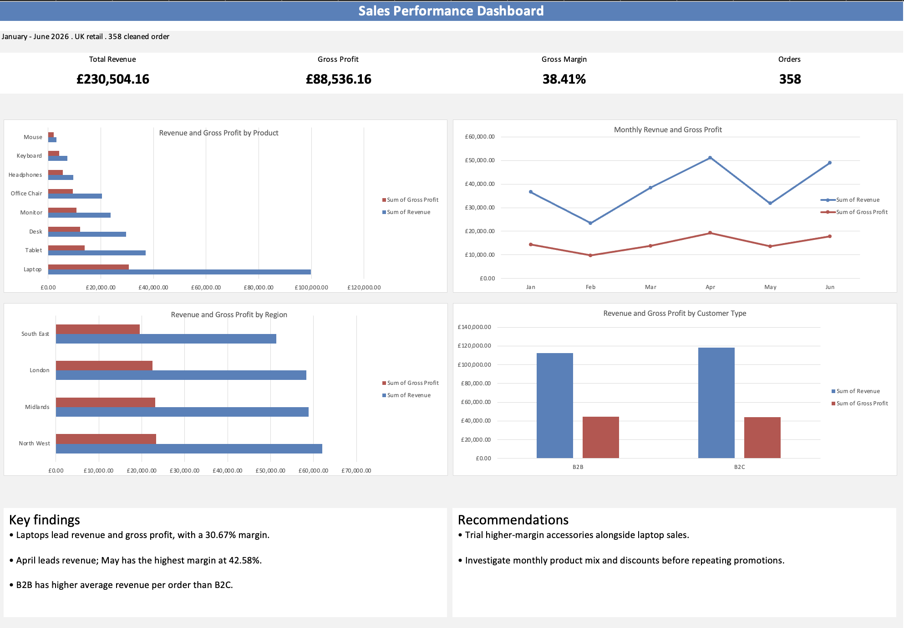

# Excel Retail Sales Analysis

An Excel analysis of fictional UK retail sales from January to June 2026, completed as a guided learning project.

## Dashboard

## Project aim

Turn messy sales records into reliable data, analyse business performance and present findings in a management dashboard.

## Tools and skills

- Microsoft Excel 365
- XLOOKUP to recover missing information from reference sheets
- TRIM and PROPER to standardise text
- Date and numeric data conversion
- Duplicate removal
- Excel Tables and structured-reference formulas
- PivotTables and charts

## Data cleaning

The original dataset contained 365 records, including duplicates, missing values and inconsistent formatting.

I:
- Recovered missing categories, customer names and unit costs using reference sheets.
- Converted text dates and numeric values into appropriate data types.
- Standardised text and customer-type labels.
- Removed five exact duplicate records.
- Excluded two records with missing quantities that could not be recovered.
- Retained sales with missing salesperson names under “Unknown”.
- Documented cleaning decisions in inspection notes and excluded records.

The final analysis contains 358 valid sales records.

## Financial calculations

- Revenue = Quantity × Unit Price × (1 − Discount Rate)
- Product Cost = Quantity × Unit Cost
- Gross Profit = Revenue − Product Cost
- Gross Margin = Gross Profit ÷ Revenue

Overall gross margin was calculated using total gross profit divided by total revenue.

## Results

| Measure | Result |
|---|---:|
| Revenue | £230,504.16 |
| Gross profit | £88,536.16 |
| Gross margin | 38.41% |
| Valid orders | 358 |

## Key findings

- Laptops generated the highest revenue (£99,857.88) and gross profit (£30,627.88), with a gross margin of 30.67%.
- Mouse sales had the highest product gross margin, at approximately 63.14%.
- April generated the highest revenue (£51,197.56), while May had the highest monthly gross margin (42.58%).
- North West generated the highest regional revenue but had the lowest regional gross margin.
- B2B customers had higher average revenue per order than B2C customers.

## Recommendations

- Trial offering higher-margin accessories alongside laptops and measure the effect on gross profit.
- Investigate monthly product mix and discounts to understand differences in gross margin.

## Limitations

- The data is fictional and intended for learning.
- Financial totals exclude two orders with unrecoverable quantities.
- Two orders cannot be attributed to a named salesperson.
- Gross profit excludes overheads and other operating expenses, so it is not net profit.
- Possible causes of performance differences require further investigation.

## What I learned

This project helped me practise choosing cleaning treatments, checking formulas and using PivotTables to answer business questions.

It also showed me that the highest revenue does not necessarily mean the highest gross margin, and that a formula can return a valid number while referring to the wrong item.

## Viewing the workbook

Download the `.xlsx` workbook from this repository and open it in Microsoft Excel to explore the cleaning notes, calculations, PivotTables and dashboard.
